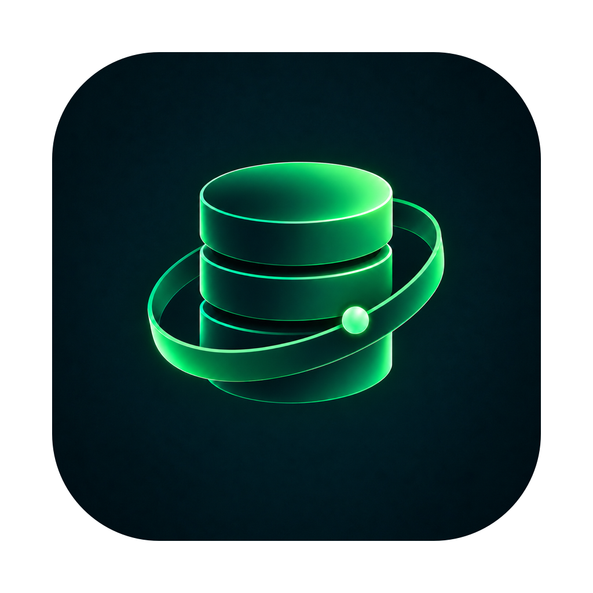
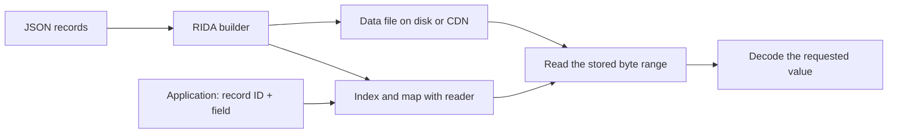

<p align="center"></p>
<h1 align="center">RIDA</h1>
<p align="center"><strong>Range Indexed Data Access</strong><br>A big file. One small read.</p>
<p align="center"><a href="https://rida.qasra.org">Website</a> · <a href="https://pypi.org/project/rida-format/">Python / PyPI</a> · <a href="https://www.npmjs.com/package/rida-format">Node.js / npm</a> · <a href="https://github.com/Qasraf/rida/releases/tag/studio-v2.0.2">Download for Mac</a></p>

Turn JSON records into a static dataset. Its index finds the stored value your application needs, and the reader retrieves that value from disk or through an ordinary HTTP byte-range request. A field can be a sentence, a complete translated help page, a product description, or a nested JSON object.

## Choose how you work

| Edition | Install or download | Published version | Requirements |
| --- | --- | --- | --- |
| Python library and CLI | `pip install rida-format` | 2.0.2 | Python 3.10+; encryption included |
| Node.js library and CLI | `npm install rida-format` | 2.0.1 | Node.js 20+; npm / npx |
| RIDA Studio | [RIDA.dmg](https://github.com/Qasraf/rida/releases/download/studio-v2.0.2/RIDA.dmg) | 2.0.2 | macOS on Apple Silicon; see [requirements](docs/MAC-APP.md) |

The package name is **rida-format** on both registries. Python imports `rida`; Node.js imports `rida-format`. npx runs the Node command; it is not a separate format or product. Edition versions are independent.

## Start in minutes

### Python

```sh
pip install rida-format
rida --version
rida scan examples/records.json
rida build examples/records.json ExampleData.rida --yes
rida get ExampleData.rida backpack-2812 hindi
```

```python
import rida

with rida.RidaFile("ExampleData.rida") as data:
    print(data.get("backpack-2812", "hindi"))
    print(data.get_many("backpack-2812", ["price", "hindi"]))
```

### Node.js / npx

```sh
npm install rida-format
npx rida-format --help
npx rida-format scan examples/records.json
npx rida-format build examples/records.json --output ExampleData.rida
npx rida-format get ExampleData.rida backpack-2812 hindi
```

```js
import { RidaReader } from "rida-format";

const reader = await RidaReader.open("./ExampleData.rida");
try {
  console.log(await reader.get("backpack-2812", "hindi"));
  console.log(await reader.getMany("backpack-2812", ["price", "hindi"]));
} finally {
  await reader.close();
}
```

Run the Python and Node build examples in separate directories, or choose different output names; builders protect existing output files. Download this repository to use its `examples/` files.

### Mac app

Open [RIDA.dmg](https://github.com/Qasraf/rida/releases/download/studio-v2.0.2/RIDA.dmg), drag **RIDA Studio** into **Applications**, then launch it. Choose a JSON file or folder, scan it, configure the output, and build. **Auto setup scans and suggests; applying a suggestion does not start a build.**

## What happens during a read?



The reader uses the catalogue to locate a value. HTTP delivery requires `206 Partial Content`; a field read does not download the complete dataset. Opening with a bundled/local index avoids an index download. The Node reader can also fetch an index; Python uses its local index/cache workflow. [How it works →](docs/HOW-IT-WORKS.md)

## Four files, four jobs

| File | Job | Keep it |
| --- | --- | --- |
| `ExampleData.rida` | Encoded field values | Disk, object storage or CDN |
| `ExampleIndex.rida` | Catalogue and metadata locating values | With the reader, or an explicitly supported index location |
| `ExampleMap.json` | Folder labels and field mappings for numbered datasets | With the reader when name resolution is needed |
| `ExampleKey.rida` | Key generated for an encrypted build | Private; never beside public download files |

Maps and generated key files depend on the build options. RIDA Studio writes a map for its builds. The catalogue lives inside the index; it is not a fifth file. [Format and mapping →](docs/HOW-IT-WORKS.md#the-map-and-the-catalogue)

## Read exactly what your screen asks for

- **Commerce:** retrieve a product's complete Hindi description, then request price and description together when the screen needs both.
- **Help centres:** organise nested folders of pages, resolve their mapped path, and read the entire Spanish page with its steps and troubleshooting.
- **Directories and reference data:** deliver known records and fields without starting a database query for each lookup.
- **Archived sensor records:** use deep folder paths for locations, devices and dates, then read one stored measurement field.

A field can be large. Reading a complete object returns the whole object, including nested content. RIDA selects top-level fields; it does not extract arbitrary nested properties. [Detailed examples →](docs/EXAMPLES.md)

## Documentation

| Guide | What you will find |
| --- | --- |
| [Python manual](docs/PYTHON.md) | Complete installation, CLI, scan/build, record IDs, local/HTTP readers, cache, encryption, API and examples |
| [Node.js / npm / npx manual](docs/NODE.md) | Complete npm installation, CLI, builder/reader APIs, JSON layouts, nested folders, encryption and examples |
| [Mac app](docs/MAC-APP.md) | Download, compatibility, installation, Auto popup, separate/shared/all groups and output files |
| [How it works](docs/HOW-IT-WORKS.md) | Byte ranges, catalogue, map, numbering, codecs, compression and integrity |
| [Build guide](docs/BUILD.md) | Input shapes, mixed schemas, group strategies, safe builds and large inputs |
| [Read guide](docs/READ.md) | Local reads, HTTP, get-many, whole records, map resolution, caching and verification |
| [CDN hosting](docs/CDN.md) | Bunny, Cloudflare, B2, your own server, HTTP requirements and cache considerations |
| [Security](docs/SECURITY.md) | AES-256-GCM, private keys, direct CDN reads, server-only Next.js keys and access-control limits |
| [Benchmarks and costs](docs/BENCHMARKS.md) | Reference measurements, modeled provider costs, SQL comparison and limitations |
| [API reference](docs/API.md) | Python and Node method names and CLI differences |
| [Hosting-cost examples](docs/COSTS.md) | Four provider arrangements, calculator assumptions and former-plan comparisons |
| [Purpose](docs/PURPOSE.md) | The foundation, former paid service and public availability |
| [Binary format](docs/FORMAT.md) | Complete byte-level format specification |
| [Troubleshooting](docs/TROUBLESHOOTING.md) | Common installation, input, output, HTTP, key and compatibility problems |
| [Website pages](docs/WEBSITE.md) | Links to every public section, terms, privacy and release information |
| [Release history](CHANGELOG.md) | Edition versions and the Mac release |

## Smaller transfers, with a stated workload

Our reference measurements use **27,647 records and 34 fields**: approximately **7.69 KB per complete JSON record** versus **143 bytes per average stored RIDA field**. Reading one average field instead of the complete record models about **98% fewer payload bytes**. HTTP headers, encryption and provider accounting add overhead. This is not a promise that every field is 143 bytes or that every bill drops by 98%. [Full measurements and assumptions →](docs/BENCHMARKS.md)

## Where it fits

RIDA fits collections built ahead of time and read repeatedly: catalogues, translations, documentation, directories and reference archives. Use a database for live writes, transactions, relational joins and dynamic queries. A project can use a database for changing data and RIDA for its static collection.

## License and availability

RIDA is free to use under the **RIDA Proprietary License**; free availability does not mean an unrestricted open-source license. Use in free or commercial applications is permitted subject to the license and attribution. Standalone redistribution and resale are restricted. See the [Python license](licenses/PYTHON-LICENSE.txt), [Node license](licenses/NODE-LICENSE.txt), and the license included with your download.

This repository contains public documentation and examples. Install the libraries from PyPI/npm. The Mac installer is provided as a GitHub Release asset rather than a large file in Git history.

**Website:** https://rida.qasra.org · **Publisher:** Qasra Foundation · **Copyright:** Syed Ali Hamza Chishty
